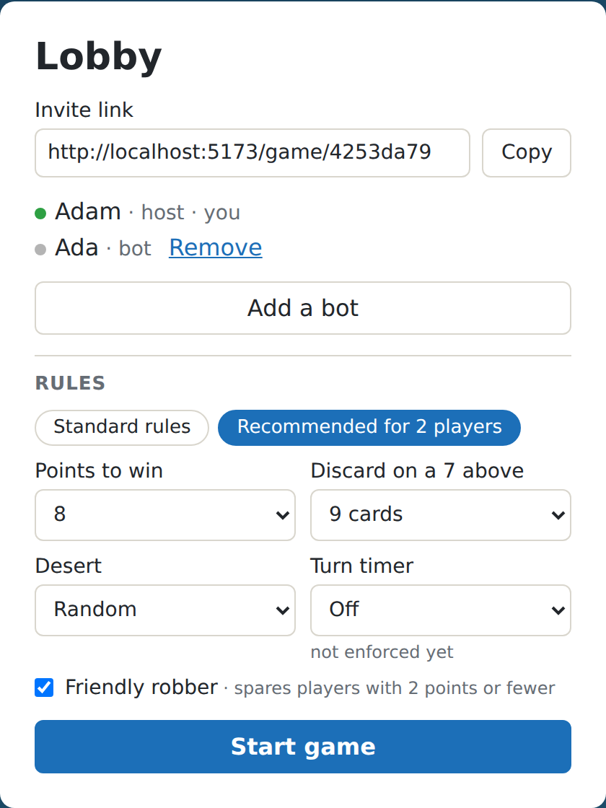
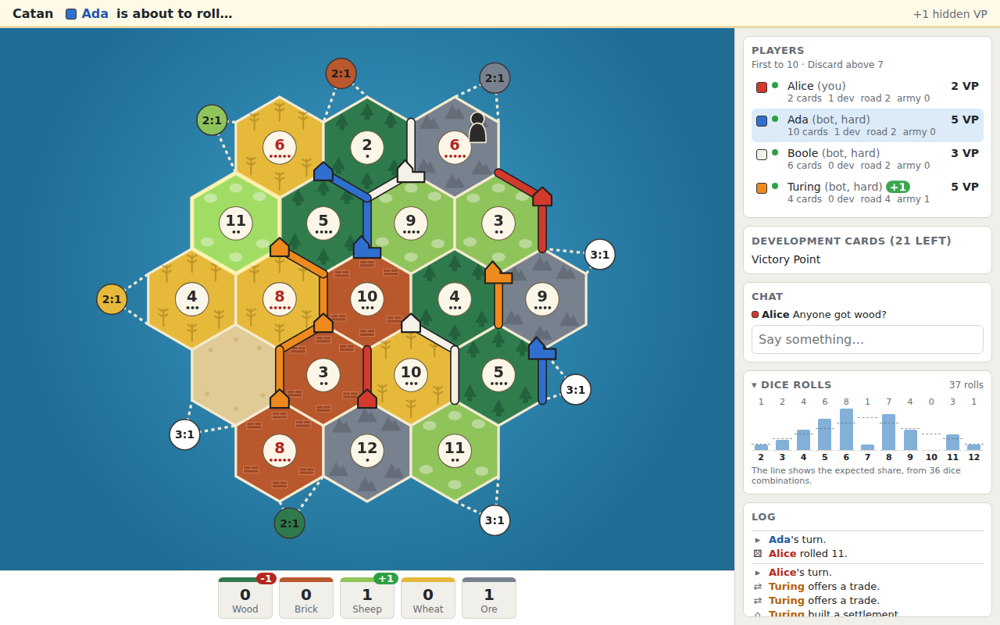

# Catan

Catan for 2–4 players in the browser, with friends over an invite link or against bots.
The full base game: setup, dice, building, the robber, development cards, bank, port and
player trade, Longest Road, Largest Army and a win at 10 points, plus chat.

The host can change the rules in the lobby: points to win (6–15), the hand limit on a 7,
the desert in the centre and a friendly robber that spares players with 2 points or fewer.
One click sets the rules we recommend for two players. The server checks every setting,
and they cannot change once the game has started.

A turn can have a time limit of 60 to 180 seconds, shown as a countdown to everyone. When it
runs out, the server makes the moves the rules require (rolling, discarding, moving the robber)
and passes the turn. After a game the host can start a rematch, which moves every player to a
new room with the same seats and rules.



Bots play at three levels, chosen by the host for each bot. In 400 games against three medium
bots an easy bot won 10% of the time and a hard bot 71.5%, against a fair share of 25%
([docs/benchmarks.md](docs/benchmarks.md#bot-tournament)). The hard bot saves for a goal,
plans its roads toward the best free spot and offers trades to the other players.
If a player leaves, anyone can hand their seat to a bot, and they can take it back by name.
After each roll the board lights up the tiles that produced and shows who got how many cards.
The side panel keeps a histogram of the dice totals and a log in the players' colours.
Shortcuts in the game: `R` rolls, `E` ends the turn, `Esc` leaves build mode.



## Running

With Docker:

```bash
docker compose up --build
```

The game is at <http://localhost:3000>. Create a room and open the invite link in another
tab or browser. Set `INTERNAL_API_KEY` in the environment outside of local play.

Without Docker you need Python 3.12, Go, Node and `redis-server`:

```bash
cd backend && python -m venv .venv && .venv/bin/pip install -r requirements-dev.txt
```

```bash
cd frontend && npm ci
```

```bash
scripts/dev.sh
```

The game is then at <http://localhost:5173>, and `Ctrl+C` stops everything.

## Architecture

```
browser ── /api ──▶ FastAPI (rules, rooms) ──▶ Redis (state, lock, pub/sub)
   └────── /ws ───▶ Go gateway (connections) ◀── room events ──┘
                       ▲ └── actions over HTTP ──▶ FastAPI
    Go bots ── /ws ────┘
```

- **backend/** (Python) decides everything. Each change runs load, validate, save and
  publish under a per-room Redis lock, so any number of workers can serve a room.
- **gateway/** (Go) holds the WebSocket connections and room membership. It forwards actions
  and fans out events, giving each seat only its own private state. It knows no game rules.
- **gateway/cmd/bots** (Go) runs one goroutine per bot. A bot is an ordinary client that picks
  from the moves the server calls legal, so it repeats no rule. Run one instance: seats are
  kept in Redis and resumed after a restart.
- **frontend/** (React, TypeScript, SVG) renders the state and the legal moves it receives.

Each seat has a secret token, kept in `sessionStorage`, so every tab is a separate player.
The token is checked on every action. Other players only ever see seat numbers and card
counts. A player whose seat is not connected can return by entering the same name.

The gateway also handles what needs no rules: chat with history, a limit of 10 messages per
second per connection, and counters at `/metrics` in the Prometheus format.

### Why Go is the gateway and the bots

The rules are not the bottleneck, and a turn-based game produces little traffic, so they stay
in Python. Go holds the connections, because that part has to survive a few slow clients and
lets backend workers scale without sticky sessions. Bots are many idle connections, which
goroutines handle cheaply.

At the size of a friends' game Go changes nothing you could notice. The measured difference
starts at thousands of messages per second, with the numbers below from
[docs/benchmarks.md](docs/benchmarks.md):

| Measured on one 16-thread machine | Result |
| --- | --- |
| Whole stack, 1 → 8 backend workers | 185 → 702 actions/s |
| Action to all players at 500 actions/s, 4 workers | p50 14.5 ms, p99 218 ms |
| Fan-out at 4,000 messages/s, 4,000 connections | p99 1.3 ms, python-socketio 24.4 ms |
| Fan-out at the load generator's limit, 4,000 connections | about 11,800 messages/s, all delivered; python-socketio delivered 8% |
| Rooms split between two gateways | 483 actions/s, no failed rooms |

The trade-offs and known limits are in [docs/design.md](docs/design.md).

## Tests

```bash
cd backend && .venv/bin/ruff check . && .venv/bin/python -m pytest --cov=app
```

```bash
cd gateway && go test -race ./...
```

```bash
cd frontend && npm test && npm run lint && npm run build
```

`scripts/check.sh` runs all of these, and `scripts/check.sh --e2e` then also plays a game in a
browser against 3 hard bots. It replaces CI, so it runs before every merge.

Backend integration tests need Redis on `localhost:6379`. `tests/simulation` plays whole
random games through serialization and checks the rules after every action.

`e2e/play.mjs` plays a full game in real browser tabs against a running stack, by clicking
the UI, and checks the lobby, errors and returning by name on the way:

```bash
cd e2e && npm ci && npx playwright install chromium
```

```bash
BASE_URL=http://localhost:5173 PLAYERS=2 BOTS=0 npm test
```

`BOTS` adds bots to the room, `BOT_LEVEL` sets their level, and `PLAYERS` sets the number of
tabs. A game takes several minutes, because the tabs play by clicking, with a simple strategy.
